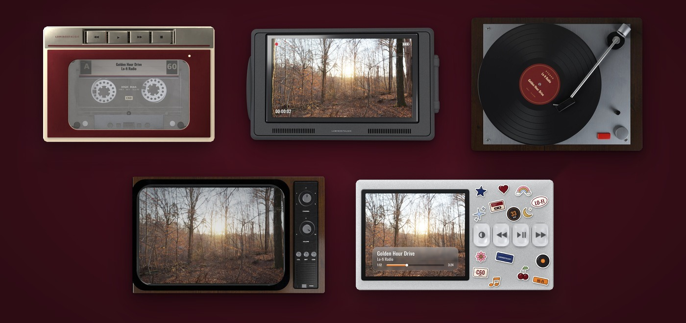

<h1 align="center">Luminostalgic</h1>

YouTube picture-in-picture, inside real retro devices.

## What it does

Click YouTube's picture-in-picture button and your video floats in a device of your choice: a cassette player, a camcorder, a vinyl turntable, a retro TV, or an MP3 player. It stays on top while you work.

- Song title and artist appear on the record label, the cassette, or the player's screen.
- Records spin, tapes wind, and the screens show the video live.
- In interactive mode you can use the device itself: drag the tonearm, press the keys and buttons, turn the dials.

## Themes

| Theme | |
|---|---|
| Cassette player | Free |
| Camcorder | Free |
| Turntable | Pro |
| Retro TV | Pro |
| MP3 player | Pro |

Pro is a one-time purchase that unlocks the Pro themes, with no subscription. Each Pro theme can be tried free for 3 minutes. One key works on up to 3 devices.

## Get it

[Add Luminostalgic to Chrome](https://chromewebstore.google.com/detail/luminostalgic-retro-pictu/aiagjhkcdpmobmncdclbeobihbjdiebh) from the Chrome Web Store.

Pro is bought once in the [Lemon Squeezy checkout](https://luminechstudio.lemonsqueezy.com/checkout/buy/920ce4bb-caba-419a-8eb1-51a0517cbcbd); the license key arrives by email.

## Support

Questions or problems: echo5vgame@gmail.com

If YouTube was already open when you installed, refresh the page once so Luminostalgic can start.

## Privacy

Luminostalgic has no tracking or analytics. See the [privacy policy](PRIVACY.md).

## License

© 2026 Arzu Rustamova (Luminech Studio). All rights reserved.
The extension is free to install; Pro themes are a one-time purchase. The source code is not public. Third-party textures and fonts keep their own licences, listed in [credits.md](credits.md).

YouTube is a trademark of Google LLC. Luminostalgic is not affiliated with or endorsed by YouTube or Google.
